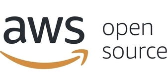
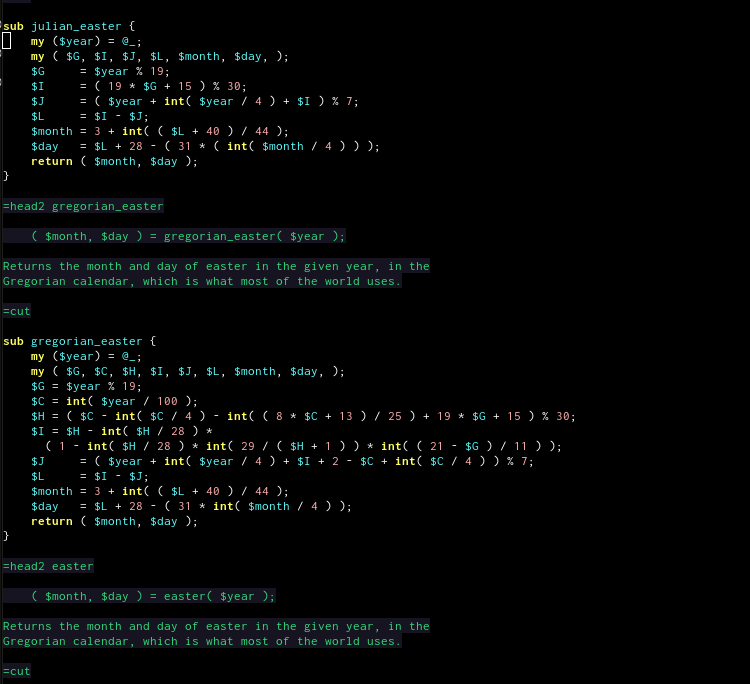
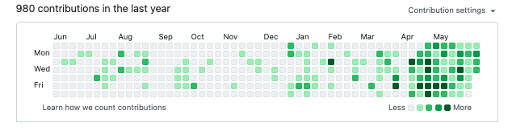
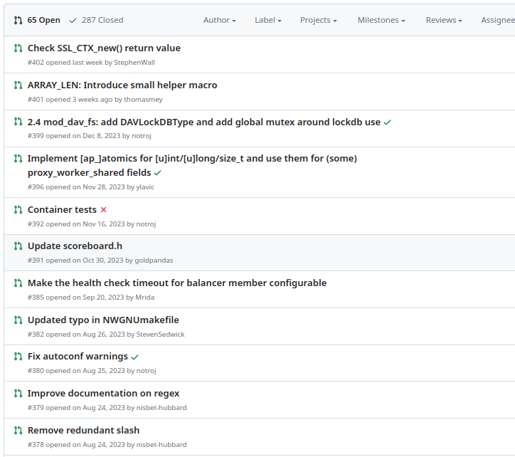
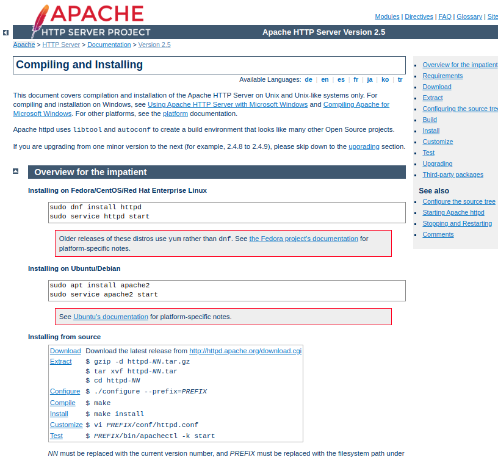
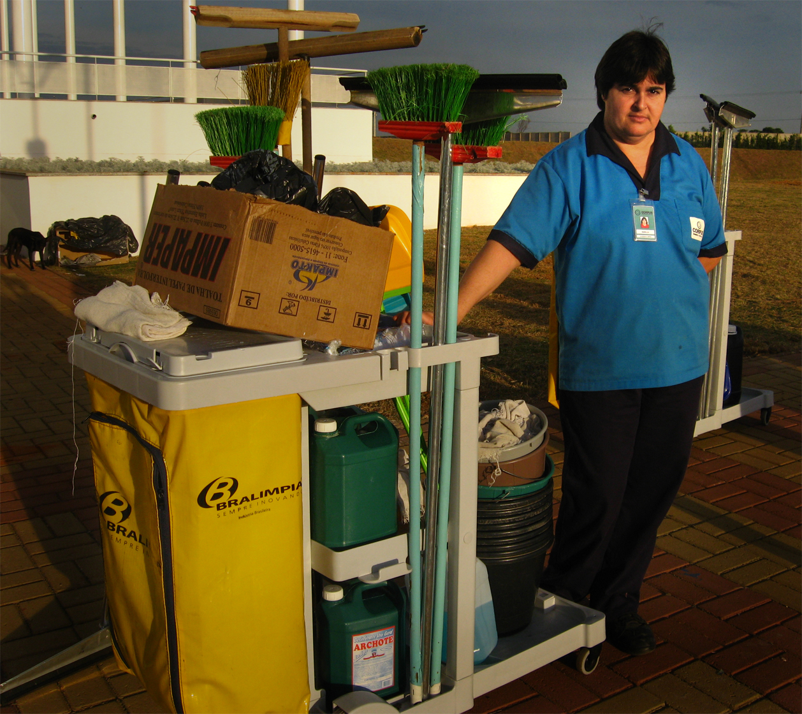
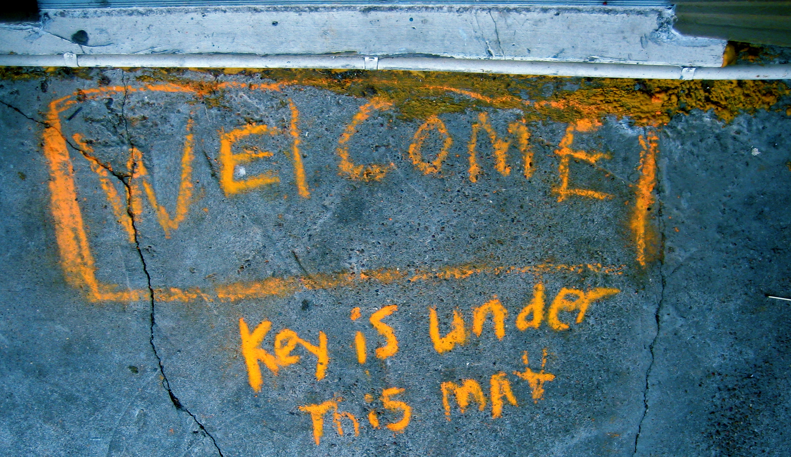
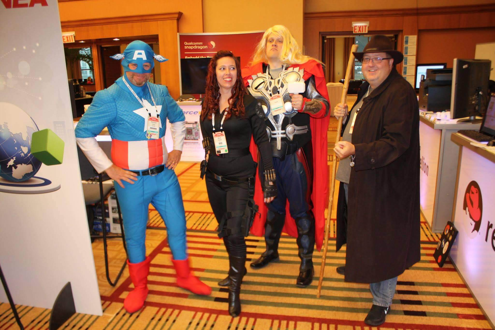
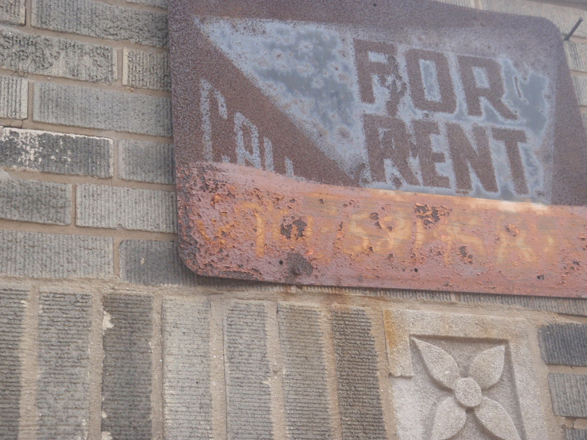
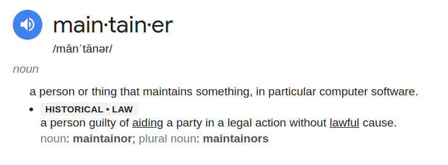

class: center, middle
# The Path To Maintainer
## Building Your Career with Open Source

Rich Bowen, (Apache|AWS)

Slides: github.com/rbowen/presentations

???

* Introduce yourself. 
    * Apache, 30+ years in FLOSS
    * Open Source Strategist at AWS
    * Member and former board member at the Apache Software Foundation
* This talk is for people who are curious about open source — maybe
  you've used it, maybe you've thought about contributing, maybe you're
  wondering whether there's actually a career here. There is, and I want
  to show you the path.

* How many of you have ever contributed to an open source project?
    * How many of you are maintainers?
    * Great. This talk is for you.
* How many of you haven't, but are curious?
    * Even better. This talk is especially for you.
* As Gertrude said in her excellent talk yesterday, open source
  participation in Africa is growing rapidly, but *maintainers* are not
  keeping pace. Let's fix that.

---

???

Motivations: Why are you here?

30 years ago, I got involved in open source because my hobby was
calendar calculations. I wasn't trying to build a career. I was trying
to figure out when Easter falls in the year 4000. That hobby turned
into a career that has taken me around the world.

I'm standing here in Togo because of a hobby that started in a small
room with a slow modem and a mailing list. Open source did that. Not
connections, not credentials, not geography. Just showing up and doing
the work.

Understand your own reasons for getting involved. Passion? Curiosity?
Career growth? All of those are valid. The important thing is to be
honest about it — with yourself and with the community.

Here's a secret: "I want to do this because it's good for my career" is
a perfectly fine motivation, as long as it's not the *only* one. The
people who stick around are the ones who genuinely care about the
project they're working on. The career benefits follow from that.

But here's the thing nobody tells you in a career talk: open source is
FUN. The puzzle-solving, the camaraderie, the arguments that turn into
friendships, the satisfaction of building something real with people
you've never met face to face — it's genuinely enjoyable. The career
benefits are a bonus. The fun is what keeps you coming back.

---

???

# The level playing field

Here's what makes open source different from every other career path
you'll encounter: nobody cares where you're from. Nobody cares what
school you went to. Nobody cares what your parents did for a living.

On a mailing list, on a pull request, in a code review — you are your
work. Period. A developer in Lomé and a developer in San Francisco
submit the same pull request, and the code either works or it doesn't.
The argument either holds up or it doesn't.

This is not true of most professional environments. But it IS true of
open source, and it's why this path is so powerful for anyone willing
to walk it — especially people who don't have traditional credentials
or connections to lean on.

---

"Win Win", CC BY — Magnus D on Flickr

???

# What companies get from open source

* influence the technology roadmap
* better recruiting and talent development
* faster problem resolution
* reduced cost of integration
* ecosystem health and business continuity
* reputation and trust
* strategic advantage

These seven benefits, from the community.apache.org website,
are meant to convince your boss to let
you spend time on open source.

But they're also what *you* will get out of investing your time in open
source communities.

Every single one of these corporate benefits has a mirror image for your
personal career. But they'll also enrich your personal life, and make
you a more interesting, accomplished, and fulfilled person.

And — if you're doing it right — it's the most fun you'll have in your
professional life. I promise.

---

community.apache.org/companies/benefits.html

* influence the technology roadmap

* better recruiting and talent development

* faster problem resolution

* reduced cost of integration

* ecosystem health and business continuity

* reputation and trust

* strategic advantage

???

Give them a second to read this, because they're not listening while
they read.

---

class: center, middle

# 1. Influence without authority

???

The corporate version: "Influence the roadmap. Decisions are made by the
people who show up."

YOUR version: you learn to lead when you have no title, no authority,
and no leverage except the quality of your ideas and your track record
of showing up.

This is the single most valuable career skill there is. Every senior
engineer, every tech lead, every staff-level IC at every company I've
ever worked at — the thing that distinguishes them is the ability to
influence without authority.

Open source is where you practice that.

---

CC by "elycefeliz" on Flickr

???

How you build this skill:

Listen more than you speak. Especially at first. Learn the community
norms. Find out who the cast of characters is. Projects are like a TV
show — they revolve around one or two strong characters. Get to know
the main actors and what role they are playing.

Figure out where the community pain points are — what's not getting
done? Who is getting burned out? How can you help with that?

Offering solutions that don't solve any real problems isn't going to get
you closer to your goal.

Career note: This is also the single most important skill in any new
job. The people who listen first and act second are the ones who earn
trust fastest.

---

CC by "Matthew Paul Argall" on Flickr

???

Be visible. Show up consistently and valuably (ie, not just
performatively)

You will never influence a project if nobody knows you're there. Where
does the community chat? Be a regular there. Answer questions. Vote when
a decision is being made. In Apache we call a non-maintainer's vote
"non-binding" — it might not count toward the final decision, but it
signals to the community that you're paying attention and that you care.

Over time, people start saying "we should ask $you about this" — and
that's the moment your influence becomes real.

---

CC by "Alan Levine" on Flickr

???

*Hint: That photo is two people arguing*

Important note: You will not win every argument.

That's ok, because you're not always right. And even when you are, you
are part of a community, and trust is, long term, more important than
being right all the time.

Learning to disagree gracefully and commit to group decisions is one of
the most valuable professional skills there is — and open source gives
you more practice at it than any other environment I know.

At Apache, we call this "community over code." The relationships matter
more than any single technical decision.

---

class: center, middle

# Build a profile that can't be faked.

???

2.  The corporate version: "Recruiting and talent development. 
Engineers who contribute upstream develop skills that are difficult
to acquire any other way."

YOUR version: every contribution you make is public. Your code, your
reviews, your discussions — they form a portfolio that any employer can
see. Unlike a resume, it can't be exaggerated. It shows how you think,
how you communicate, and how you handle feedback.

This is enormously valuable when you're looking for a job, and it's
something that no amount of interview prep can replicate.

---

# Skills you can't learn in a classroom

* Code review across a large, distributed codebase
* Communicating technical ideas in writing, to strangers
* Navigating disagreements and building consensus
* Project management without authority
* Working across time zones, cultures, and organizations

???

These are not just "open source skills." These are the skills that
distinguish a senior engineer from a junior one, and a leader from
someone who just writes code. The open source contribution process
forces you to develop these faster than almost any other environment.

Companies pay senior engineers six figures for these skills. You can
develop them for free, starting today, by contributing to open source.

---

???

Reviewing PRs and issues is one of the most powerful skill-builders
available to you.

It teaches you about the codebase. It makes you visible. It improves the
code for everyone. It teaches you what people care about, what's broken,
and how you can be useful.

From a career standpoint, code review is one of the most in-demand
skills in software engineering. Being able to say "I review PRs on
Apache $project" in an interview is remarkable. It's proof that you can
read, reason about, and give feedback on code you didn't write — which
is what senior engineers do all day.

---

???

Documentation can always be improved. And doc improvements are almost
always appreciated.

Working on the docs is also one of the very best ways to learn about a
project. And writing clearly — explaining complex things simply — is
a skill that pays dividends across your entire career.

Fix spelling and grammar errors. Improve the getting-started guide.
Translate the docs into French, or Éwé, or any language the project
doesn't yet cover.

Don't underestimate documentation work. Some of the most respected
people in open source are known primarily for docs, not code.

---

class: center, middle

# 3. Build relationships that solve problems

???

The corporate version: "Faster problem resolution. When your engineers
have existing relationships with maintainers, bug reports get triaged
faster."

YOUR version: when you have relationships with maintainers — because
you ARE one of the maintainers, or you're a regular contributor they
recognize — your problems get solved faster. Your career problems get
solved faster, too.

I got every single job I've had in the last 20 years because of
relationships that started in open source.

Not through awkward mixers or LinkedIn requests, but through actually
working together on something real. Some of the most important
professional relationships of my life came from open source — people
who recommended me for jobs, invited me to speak at conferences, and
taught me things I couldn't have learned any other way.

Think about what that means for you. Right now, today, you can start
collaborating with engineers at Google, at AWS, at Meta, at startups
you've never heard of that will be worth billions next year. Not by
cold-emailing them. Not by networking events. By working alongside them
on something real. They'll know your name because you reviewed their PR
or fixed a bug they cared about. That's an introduction no recruiter
can manufacture and no LinkedIn connection request can replicate.

Open source is the great network equalizer.

---

???

The best time to plant a tree is 20 years ago. The next best time is
now.

A junior developer once asked me how he could gain the same stature as
me in open source. I said, well, you start contributing, and you keep at
it, consistently, for 20 years. He said, no, I mean now.

There is no shortcut. But the good news is that every step along the
way is valuable — you don't have to wait 20 years to start benefiting.
Your first PR review teaches you something. Your first docs fix makes
you visible. Your first mailing list reply makes you known. It
compounds.

---

CC by "scapeGOATofPIE" on Flickr

???

Patience. Earning trust takes time. If you are impatient, or pushy, you
will be unsuccessful.

This is true in open source and it's true in careers generally. The
people who build lasting reputations are the ones who show up
consistently, not the ones who make a big splash and disappear.

---

### "We opened a PR 2 weeks ago, and it hasn't been reviewed yet. Is it ok to go ahead and fork now?"

???

Open source projects are mostly composed of volunteers, with limited
time. You cannot expect that simply opening a ticket or a PR is going to
be the sole interaction that will put you in view of the project.

Becoming a maintainer — or even just getting one change merged —
involves conversation and earning trust. This may be annoying if this is
your *job* rather than your *passion*. But it's how it works.

The relationships you build along the way are the point. Not just the
merge.

---

class: center, middle

# Also: it's fun.

???

I keep talking about career benefits, and they're real. But let me be
honest about something: I don't do this for my career. I do it because
it's genuinely, deeply enjoyable.

Working on a hard problem with smart people who care — that's fun.
Getting a message from someone on the other side of the world who used
your code to solve their problem — that's fun. Arguing about API design
at 11pm because you can't stop thinking about it — that's fun. Showing
up at a conference and meeting the person you've been collaborating with
for three years and discovering they're exactly as weird as you imagined
— that's fun.

If you're not having fun, you won't stick around long enough for the
career benefits to materialize. So find a project that genuinely
interests you. The joy is the fuel.

---

class: center, middle

# 4. Fix it at the source

???

The corporate version: "Reduced integration cost. Contributing fixes
upstream means they ship in the next release for everyone."

YOUR version: you learn to work upstream rather than carrying patches.
This is the difference between a junior who hacks around problems
locally and a senior who fixes them at the source for everyone.

When you contribute a fix upstream, you never have to maintain it again.
It ships in the next release. It gets tested by the entire community.
If it needs updating, someone else might do it. You've reduced your own
maintenance burden to zero.

This is the senior engineer mindset: don't work around the problem.
Fix the problem for everyone. And open source is where you develop that
instinct.

---

CC by "Carlos Ebert" on Flickr

???

A good maintainer is a janitor, not a CEO.

They clean up messes. They make the place beautiful and welcoming for
others. They work hard and bring real value, and are only noticed when
they miss things.

This is also true of the best leaders I've worked with in any context.
The people who do the unglamorous work — rebasing, fixing CI, triaging
stale issues — are the ones everyone trusts.

Carry your own weight, and then carry a little more. That's what gets
noticed.

---

class: center, middle

# 5. Become indispensable

???

The corporate version: "Ecosystem health as business continuity. The
projects you depend on are maintained by a small number of people, often
without dedicated funding. Contributing engineering time is a direct
investment in continuity."

YOUR version: when you invest in the sustainability of what others
depend on, you become the person no one can afford to lose.

If you're the one keeping the project alive — reviewing PRs, mentoring
new contributors, ensuring releases happen on time — you are
indispensable. Not just to the project, but to every company that
depends on it. That's career security that no single employer can
provide.

---

# Open source is not a renewable resource

* Maintainers burn out
* Companies take without giving back
* Single-maintainer projects are fragile
* If the project you depend on dies, what happens to your career?

???

If you're building your career on open source — which I'm encouraging
you to do — then you should care deeply about the sustainability of
the projects you're involved in. That means contributing to their
health, mentoring new contributors, and helping ensure that the project
outlasts any single person.

---

CC by "alborzshawn" on Flickr

???

Be welcoming. This is where open source starts to teach you leadership.

What do you wish someone had done for you when you started contributing?
Do that.

Acknowledge and thank new contributors. Improve the onboarding
documentation. When you welcome someone new, you are mentoring. When
you improve onboarding docs, you are making the project more
sustainable. These are leadership skills, and they matter far beyond
open source.

---

# Mentoring: The multiplier

* The project's future depends on new maintainers
* Teaching deepens your own understanding
* It builds your reputation as a leader, not just a contributor
* The people you mentor become your professional network for life

???

I got involved in open source because someone asked me to. Ken Coar
encouraged me to submit a paper to a conference when I was sure I had
nothing to say. Jim Jagielski told me to go fix the docs myself rather
than waiting for someone else. Sally Khudairi encouraged me to get
involved in ASF governance.

Each of those nudges changed the trajectory of my career. You have the
same power to change someone else's.

---

# How to mentor in open source

* **Ask people to do things.** Directly. Specifically.
* **Give them permission.** Confidence is important.
* **Trust them.** That's why you have revision control.
* **Set expectations.** Standards show you take them seriously.
* **Let them fail.** Then help them turn failure into success.

???

"Micromentoring" — asking people to do one specific task instead of
doing it yourself — takes 2 minutes but conveys trust, permission, and
belonging. It's one of the most effective things you can do.

"Can you look at this bug?" is more effective than "come help."

---

class: center, middle

# 6. Reputation is currency

???

The corporate version: "Reputation and trust. Companies known for
contributing — not just consuming — earn trust from foundations,
maintainers, and the broader developer community."

YOUR version: in open source, reputation is currency. And unlike a
corporate title, it's portable. It follows you from job to job, company
to company, continent to continent.

At Apache, we say trust is earned by individuals. Your personal
reputation is yours — your employer didn't earn it, and they can't take
it away when you leave.

This is especially powerful for people early in their careers, and for
people who don't come from established tech hubs. Your reputation in
open source is built on what you DO, not who you know or where you
come from.

---

???

Dress for the job you want, not the one you have.

In open source, this means: act like a maintainer before you are one.
Review PRs like a maintainer would. Respond to questions like a
maintainer would. Take ownership like a maintainer would.

The title will catch up to the behavior. This works in your career too.
The promotion usually follows the behavior, not the other way around.

---

???

Where I live, there's a law that says that if you occupy a piece of land
for 10 years, and nobody challenges you on it, that's yours now. Open
source is the same way. Sort of.

If you show up, consistently, and do the work, and nobody objects...
eventually the community recognizes that you belong there. The formal
title is just documentation of what was already true.

---

CC by "Anthony Easton" on Flickr

???

Think of yourself as an owner, not a renter.

If you think of a place as your own, you will treat it very differently.
And you will treat "visitors" very differently.

Don't act like an outsider trying to break in. Act like you're at
home and just haven't been given your own keys yet.

---

class: center, middle

# 7. Shape the future

???

The corporate version: "Strategic advantage. Collaborating in projects
is one of the most effective ways to shape industry standards."

YOUR version: when you participate in open source, you are shaping the
tools and standards that the entire industry will use tomorrow. You're
not just consuming technology — you're defining it.

This gives you an enormous strategic advantage in your career. You know
what's coming before everyone else, because you're helping build it.
You develop expertise in the next version of the technology while
everyone else is still reading the release notes.

---

# Where open source careers go

* Software engineering (with a deep upstream specialty)
* Developer advocacy and relations
* Community management
* Open source program offices (OSPOs)
* Foundation leadership and governance
* Technical writing and documentation
* Security research and auditing

???

"Open source" is not a job title, but it's a lens on many different
careers. Companies of all sizes are actively hiring people with open
source experience because they need people who know how to work in the
open, collaborate across organizations, and engage with communities
their products depend on.

And beyond traditional employment — open source experience qualifies
you for foundation board positions, conference speaking, book writing,
consulting, and other things that broaden your career in ways a single
employer never could.

---

# Talking to your employer about open source

* Don't lead with philosophy. Lead with business value.
* "This project is critical to our product. We should have a voice."
* "Contributing upstream saves us the cost of maintaining patches."
* "Our engineers learn faster by participating in public code review."
* Speak their language: supply chain, risk, cost, talent retention.

???

At some point in your career, you will need to persuade a manager that
open source contribution is worth your company's time. This is an
essential skill, and it gets easier with practice.

The key is to frame it in terms they care about — costs, risks,
recruiting, and customer trust — not in terms of philosophy or ideology.

The Apache benefits page gives you the language to do this:
community.apache.org/companies/benefits.html

---

???

Definition: There is no consistent, standard definition of "maintainer."

At the ASF, we divide it into Committer and PMC Member. Committers can
make changes to the source code. PMC members are the gatekeepers on
releases, and determine who will become a committer or PMC member.

In general, it refers to someone who makes decisions about a project.

This varies enormously from one project to another. Some projects give
a lot of voice to non-code contributors. Others have a high bar.
Understanding a project's specific governance is your first research
task.

---

Photo CC by James Mann on Flickr

???

Disclaimer: Every project is different and unique in ways that no
presentation can prepare you for, because projects are made of people,
and people have inscrutable motives and egos.

Some projects will literally make you a maintainer the first day, while
others never will, no matter how much you contribute.

Hopefully the advice I'm giving will be applicable for most healthy
projects.

---

# Start today

???

I know I said patience. And I meant it — building trust takes time. But
starting takes no time at all.

---

# This week:

1. **Pick a project you use.** Something you care about.
2. **Read the contributor guide.** Every project has one (or should).
3. **Join the community channel.** Mailing list, Slack, Discord — wherever
   they talk. Lurk for a week.
4. **Find one thing to improve.** A typo in the docs. A question you can
   answer. A bug you can reproduce and report well.
5. **Do it.** Then do it again next week.

???

That's it. It's not complicated. It just takes consistency. And the
career you build from it will be unlike anything you could build by
just showing up to a job.

The beauty of this path is that it's available to everyone in this room
right now, today, for free. All you need is curiosity, patience, and
an internet connection. Where you are in the world doesn't matter. Your
background doesn't matter. Your credentials don't matter. Show up, do
good work, be kind to people. The rest follows.

---

## What you build for yourself:
## is what employers pay for.

???

That's the whole talk in one line. The skills that make you a great open
source contributor are the same skills that companies pay senior
engineers for. The reputation you build in a project is the portfolio
that gets you hired. The relationships you form with co-contributors
are the network that creates opportunities.

It's not charity. It's not volunteering. It's investing in yourself by
investing in something bigger than yourself.

---

class: center,middle
## finis

rbowen@apache.org

@rbowen

Slides: github.com/rbowen/presentations
